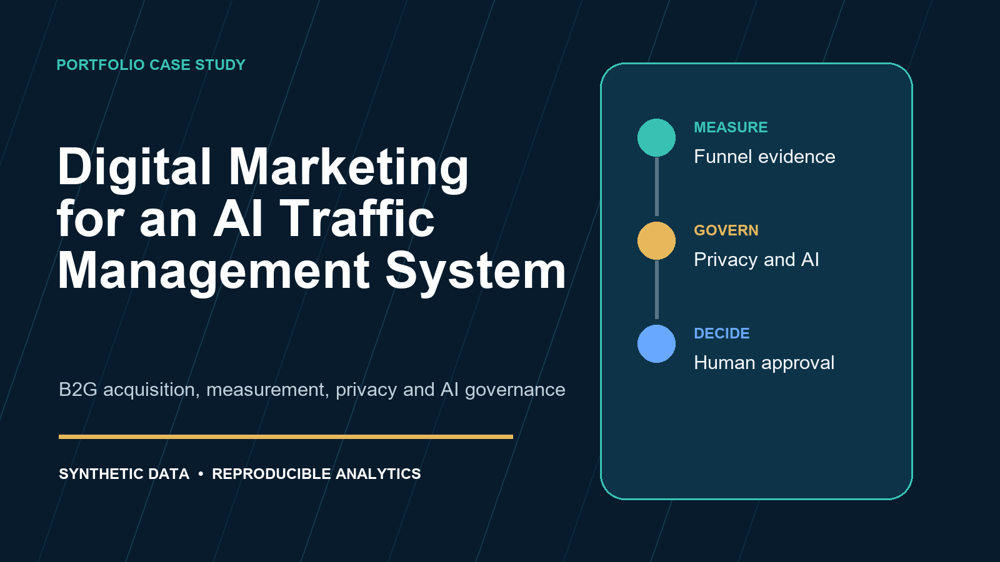

# Digital Marketing for an AI Traffic Management System

[](https://github.com/spirosgro/digital-marketing-ai-traffic-system/actions/workflows/validate.yml)


A public portfolio case study that turns a university presentation into a measurable,
privacy-aware B2G acquisition system for a hypothetical AI-enabled urban traffic solution.
It combines positioning, municipal buying-committee analysis, campaign governance, an
executable KPI engine, synthetic funnel data, AI governance, and a pilot-oriented roadmap.

> **Scope:** This is an educational scenario. It is not a real company, product claim,
> customer engagement, or municipal deployment. All performance data is synthetic.



## Decision question

How should a supplier market an AI traffic-management pilot to European public buyers while
preserving evidence quality, long-cycle attribution, privacy, procurement readiness, and
human accountability?

## What this repository demonstrates

- A B2G funnel built around municipal outcomes and buying committees.
- A governed UTM taxonomy and channel measurement model.
- Reproducible calculations for CTR, engagement, qualified leads, opportunities, pilots,
  unit costs, channel score, and constrained budget allocation.
- Privacy and AI governance aligned with GDPR, EDPB consent guidance, the EU AI Act, and
  the NIST AI RMF.
- A pilot-first go-to-market path that respects public procurement and avoids unsupported
  performance claims.

## Repository contents

- [Executive report](report/digital-marketing-ai-traffic-system.pdf)
- [Editable report](report/digital-marketing-ai-traffic-system.docx)
- [Presentation](presentation/digital-marketing-ai-traffic-system.pdf)
- [Editable presentation](presentation/digital-marketing-ai-traffic-system.pptx)
- [System architecture](architecture/system-architecture.md)
- [Channel plan](campaigns/channel-plan.csv)
- [UTM governance](campaigns/utm-governance.md)
- [Synthetic campaign dataset](data/synthetic-campaign-performance.csv)
- [KPI framework](measurement/kpi-framework.md)
- [Calculated KPI output](output/channel-kpis.csv)
- [Budget recommendations](output/budget-recommendations.csv)
- [Privacy and AI governance](governance/privacy-and-ai-governance.md)
- [Methodology and limitations](docs/methodology-and-limitations.md)

## Reproduce the analysis

Python 3.10 or newer is sufficient. The analytics engine uses only the standard library.

```bash
python src/marketing_analytics.py
python -m unittest discover -s tests -v
python scripts/validate_repo.py
```

The script reads the synthetic dataset and scenario constraints, then rebuilds the files in
`output/`. Budget recommendations are decision support. A human owner must review volume,
channel fit, data confidence, legal basis, and procurement stage before spending changes.

## Design principles

1. Sell a measurable pilot outcome, not an unverified AI promise.
2. Treat the municipality as a buying committee, not a single lead.
3. Separate marketing analytics from operational traffic telemetry.
4. Collect the minimum data needed for a stated purpose.
5. Label synthetic assumptions and keep claims traceable to evidence.
6. Keep final budget and deployment decisions under accountable human control.

## Limitations

This repository does not model tender law by jurisdiction, traffic-signal safety assurance,
production machine learning, causal lift, multi-touch identity resolution, or real municipal
sales cycles. Conversion rates and budgets are illustrative and must not be treated as market
benchmarks.

## Responsible use

Do not use the example to profile residents, infer sensitive traits, bypass consent, scrape
personal accounts, target vulnerable groups, or automate public-sector decisions. A real
traffic system requires independent safety engineering and regulatory classification.
