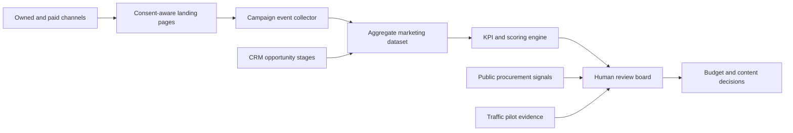

# Measurement and decision architecture

## Boundary

The marketing layer handles campaign identifiers, aggregate engagement, and opportunity
stages. It does not ingest raw camera feeds, vehicle identifiers, location histories, or
resident profiles. Operational traffic evidence enters only as approved, aggregate pilot
metrics with provenance and review status.

## Control points

| Control point | Purpose | Evidence |
|---|---|---|
| Consent gate | Prevent optional analytics before valid consent | Consent configuration and test log |
| Campaign registry | Standardise source, medium, campaign, and content values | Approved UTM register |
| Data minimisation | Keep only fields required for funnel analysis | Data dictionary and retention rule |
| Claims review | Link product and impact statements to owned evidence | Claims register |
| Human budget approval | Prevent automatic spending changes | Decision record |
| Separation of systems | Protect operational traffic data from marketing use | Architecture review |
